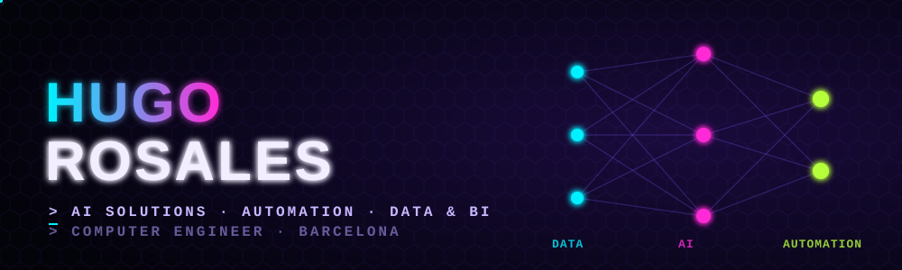

<p align="center">
  
</p>

<p align="center">
  
</p>

<p align="center">
  <a href="https://www.linkedin.com/in/hugo-rosales-llorente-5a1170298/"></a>
  <a href="mailto:hugorosales2003@gmail.com"></a>
  
</p>

## `> whoami`

Computer Engineer (UAB, 2026) working where **AI, automation and data** meet the business. I like taking a messy manual process, understanding who suffers it, and turning it into something automated, measurable and easy to use.

- 🔭 Focus: **AI solutions & automation**, **data analytics / BI** and **IT project management**
- 🧠 Thesis: lightweight neural networks for image compression
- 🌍 Catalan & Spanish (native) · English (advanced)
- 📫 Open to junior roles in Barcelona or remote

## `> experience.log`

**IT & Digital Innovation Intern — Schneider Electric** · *Jul 2025 – Jun 2026*

```diff
+ Co-coordinated an NFC rollout across 120+ European sites
+ Built Power BI & Tableau dashboards on ServiceNow data
+ Automated recurring workflows with Power Automate
+ Launched the internal AI hub on SharePoint
+ Supported the audit-readiness plan for IT rooms
```

## `> stack --list`

**AI & Automation**  
   

**Data & BI**  
    

**Digital Workplace**  
 

**Dev toolkit**  
    

## `> ls ./featured-projects`

<table>
  <tr>
    <td width="50%" valign="top">
      <h3>▸ Neural Image Compression</h3>
      <p>Lightweight neural networks for image compression (Bachelor's thesis, UAB).</p>
      <p><code>PyTorch · Python</code></p>
      <p><a href="https://github.com/HugoRosaless/REPO">View repo →</a></p>
    </td>
    <td width="50%" valign="top">
      <h3>▸ IT Service Desk Analytics</h3>
      <p>End-to-end ITSM analytics: Python/SQL pipeline + Power BI dashboard on synthetic ServiceNow-style data.</p>
      <p><code>Python · SQL · Power BI</code></p>
      <p><a href="https://github.com/HugoRosaless/REPO">View repo →</a></p>
    </td>
  </tr>
  <tr>
    <td width="50%" valign="top">
      <h3>▸ AI Job-Hunter Agent</h3>
      <p>Agent that collects job offers, ranks them with an LLM and sends a daily digest.</p>
      <p><code>Python · LLM API · Automation</code></p>
      <p><a href="https://github.com/HugoRosaless/REPO">View repo →</a></p>
    </td>
    <td width="50%" valign="top">
      <h3>▸ Docs Assistant (RAG)</h3>
      <p>Chat assistant that answers questions over internal docs, with a live demo.</p>
      <p><code>Python · RAG · Streamlit</code></p>
      <p><a href="https://github.com/HugoRosaless/REPO">View repo →</a></p>
    </td>
  </tr>
</table>

## `> git log --graph`

<p align="center">
  <picture>
    <source media="(prefers-color-scheme: dark)" srcset="https://raw.githubusercontent.com/HugoRosaless/HugoRosaless/output/github-snake-dark.svg"/>
    
  </picture>
</p>

<p align="center"><code>// EOF — thanks for scrolling. Let's build something smart.</code></p>
